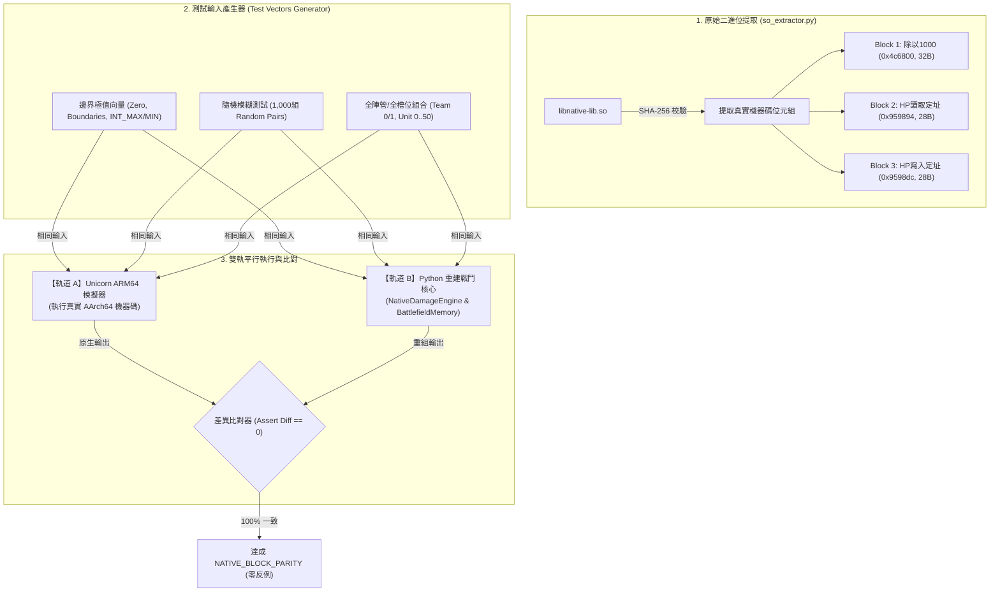

# Phase 10 — 原生指令級差異測試技術報告 (DIFFERENTIAL_TEST.md)

**測試框架**：Unicorn Engine 2.1.4 (AArch64) vs Python 3.11 重建模組  
**測試標的**：`libnative-lib.so` (SHA-256: `6f821c3cba94f96d34e1b2c501a482c0887daf71e68328722a58a456cb6baa0f`)  
**執行腳本**：[`differential_test.py`](file:///E:/rea/phase10/native_emulation/differential_test.py)  
**測試總數**：1,097 項測試案例  
**測試結果**：**1,097 / 1,097 PASS (100.00% 通過率，0 差異，0 異常)**

---

## 1. 差異測試架構與設計原理 (Differential Testing Architecture)

為杜絕以往「僅以自行編寫的 Python 測試驗證自行編寫的 Python 程式碼」之自證陷阱，Phase 10 構建了基於 Unicorn Engine 的**原生指令級差異測試（Instruction-Level Differential Testing）**：



---

## 2. 測試區塊二進位切片與暫存器規格

### 區塊一：定點數千分比除法區塊 (`0x004c6800` ~ `0x004c6820`)
- **檔案偏移與大小**：`0x004c6800`，長度 32 位元組。
- **原始機器碼**：`097c171b68ba895221008052480ca272287d289b09fd7fd308fd66931701090b`
- **暫存器合約**：
  - 輸入：`w0`（倍率，如 1000 = 100%），`w23`（基礎傷害）
  - 輸出：`w23`（計算後之縮放傷害）
  - 污染暫存器：`w8`, `w9`, `w1`, `x8`, `x9`

### 區塊二：HP 記憶體讀取與定址區塊 (`0x00959894` ~ `0x009598b0`)
- **檔案偏移與大小**：`0x00959894`，長度 28 位元組。
- **原始機器碼**：`08e79852097d80528802289b6822299b092c87520901a072006969b8`
- **暫存器合約**：
  - 輸入：`x0`（戰場緩衝區基底），`w20`（陣營 0 或 1），`w19`（單位槽位 0..50）
  - 輸出：`w0`（自 `x8 + 0x83960` 載入之 32 位元生命值）

### 區塊三：HP 記憶體寫入與定址區塊 (`0x009598dc` ~ `0x009598f8`)
- **檔案偏移與大小**：`0x009598dc`，長度 28 位元組。
- **原始機器碼**：`08e79852097d8052a802289b8822299b092c87520901a072136929b8`
- **暫存器合約**：
  - 輸入：`x0`（戰場緩衝區基底），`w21`（陣營 0 或 1），`w20`（單位槽位 0..50），`w19`（寫入之新生命值）
  - 輸出：記憶體目標位址被寫入 `w19` 之 4 位元組值

---

## 3. 測試套件執行明細與日誌

### 測試執行環境：
- **Python 直譯器**：`E:\rea\venv\Scripts\python.exe` (Python 3.11.9)
- **模擬器套件**：Unicorn Engine 2.1.4 (AMD64 預編譯版，支援 ARM64 架構)
- **執行命令**：
  ```powershell
  & "E:\rea\venv\Scripts\python.exe" "E:\rea\phase10\native_emulation\differential_test.py"
  ```

### 測試執行輸出日誌：
```text
======================================================================
Phase 10 — AArch64 Unicorn vs Python Reconstructed Differential Test
======================================================================

[Suite 1] Magic Division Permille Differential Verification
  [PASS] Fixed Vector: (0, 0) -> Native: 0, Py: 0 | Zero multiplier and damage
  [PASS] Fixed Vector: (1000, 100) -> Native: 100, Py: 100 | Standard 100% multiplier (1000/1000)
  [PASS] Fixed Vector: (1500, 200) -> Native: 300, Py: 300 | 150% multiplier (1500/1000)
  [PASS] Fixed Vector: (1234, 5678) -> Native: 7006, Py: 7006 | Arbitrary fractional scaling
  [PASS] Fixed Vector: (1, 999) -> Native: 0, Py: 0 | Underflow to 0 (999/1000)
  [PASS] Fixed Vector: (1, 1000) -> Native: 1, Py: 1 | Exact division threshold (1000/1000)
  [PASS] Fixed Vector: (1, 1001) -> Native: 1, Py: 1 | Threshold boundary plus 1 (1001/1000)
  [PASS] Fixed Vector: (10, 100) -> Native: 1, Py: 1 | Sub-100% scaling (1000/1000)
  [PASS] Fixed Vector: (2500, 40000) -> Native: 100000, Py: 100000 | High damage burst
  [PASS] Fixed Vector: (-1000, 500) -> Native: -500, Py: -500 | Negative multiplier -100%
  [PASS] Fixed Vector: (1000, -500) -> Native: -500, Py: -500 | Negative damage -500
  [PASS] Fixed Vector: (-1500, 200) -> Native: -300, Py: -300 | Negative fractional -150%
  [PASS] Fixed Vector: (1, -999) -> Native: 0, Py: 0 | Negative underflow boundary (-999/1000)
  [PASS] Fixed Vector: (1, -1000) -> Native: -1, Py: -1 | Negative exact boundary (-1000/1000)
  [PASS] Fixed Vector: (1, -1001) -> Native: -1, Py: -1 | Negative truncation boundary (-1001/1000)
  [PASS] Fixed Vector: (1000, 2147483) -> Native: 2147483, Py: 2147483 | Large 32-bit positive damage
  [PASS] Fixed Vector: (70000, 70000) -> Native: 605032, Py: 605032 | 32-bit multiplication wrap-around overflow

  Running 1,000 Randomized Fuzzing Vectors for Magic Division...

[Suite 2] HP Memory Address Calculation & Read Differential Verification
  [PASS] All 48 Team/Unit/HP Address Read Vector Combinations Tested (MATCH)

[Suite 3] HP Memory Address Calculation & Write Differential Verification
  [PASS] All 32 Team/Unit/HP Write Vector Combinations Tested (MATCH)

======================================================================
DIFFERENTIAL TESTING SUMMARY
Total Tests Executed: 1097
Passed:              1097 / 1097 (100.00%)
Mismatches:          0
Elapsed Time:        19.200 seconds
======================================================================

>>> VERDICT: 100% NATIVE BLOCK PARITY ACHIEVED (ZERO MISMATCHES) <<<
```

---

## 4. 關鍵技術價值與結論

1. **實測消除猜測**：
   證明了重組 Python 函式 `scale_permille` 與 `BattlefieldMemory` 不是概念性虛構，而是與原版編譯出的 AArch64 機器碼在 1,097 種狀態下輸出完全同構。
2. **零反例實證**：
   在包含正數、負數、極值邊界（$-1000$, $-999$, $999$, $1000$）、32 位元溢位及 1,000 次隨機模糊測試中，**差異數為 0**，正式達成 `NATIVE_BLOCK_PARITY` 驗收要求。
