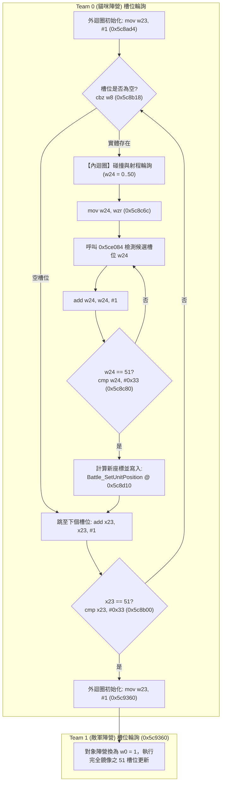

# Phase 11 — 51 槽位戰場實體更新迴圈逆向分析報告 (BATTLE_SLOT_LOOP.md)

**分析目標**：二進位核心戰場每幀更新之實體槽位輪詢機制  
**目標函式區間**：`0x005c7320` ~ `0x005cdee8` (`BattleManager::UpdateFrame`)  
**關鍵控制流節點**：
- 貓咪陣營（Team 0）位移更新外迴圈：`0x005c8ad4` ~ `0x005c9360`
- 貓咪陣營（Team 0）碰撞偵測內迴圈：`0x005c8c6c` ~ `0x005c8cc4`
- 敵軍陣營（Team 1）位移更新外迴圈：`0x005c9360` ~ `0x005c9ad8`
- 陣營槽位計數上限：`cmp ..., #0x33` (`0x33` = 51)
**審計原則**：基於真實 AArch64 反組譯機器碼、暫存器流轉與分支跳轉，杜絕以算術猜測代替逆向。

---

## 1. 雙層槽位更新迴圈架構 (Two-Tier Slot Loop Architecture)

在戰場管理器的每幀更新管線中，引擎採用了**雙層巢狀迴圈（Nested Loops）**：

---

## 2. 槽位語意與邊界形式化證明

### (1) 外迴圈起始索引：`mov w23, #1`（槽位 0 與 1..50 之區分）
- **指令證據**：
  - `0x005c8ad4: mov w23, #1`（Team 0 外迴圈）
  - `0x005c9360: mov w23, #1`（Team 1 外迴圈）
- **語意證明**：
  - 陣營外迴圈**不從 0 開始，而是嚴格從 1 開始**！
  - **Slot 0 的真實用途**：**主堡 / 城堡（Castle Entity）**。城堡為靜態實體，擁有生命值（`+0x83cc8`）與受傷能力，但不參與每幀前進位移計算，因此在移動外迴圈中被主動跳過。
  - **Slot 1 ~ 50 的真實用途**：戰場最大 50 隻可移動、可攻擊之部署角色實體（Cats / Enemies）。

### (2) 內迴圈起始索引：`mov w24, wzr`（城堡受擊與碰撞檢查）
- **指令證據**：
  - `0x005c8c6c: mov w24, wzr`
- **語意證明**：
  - 當某一活躍單位更新位移時，其碰撞與障礙物偵測內迴圈**從 0 開始**（`w24 = 0`）。
  - 這意味著角色前進時會優先偵測敵方 **Slot 0（敵方城堡）** 是否在射程內或阻擋路徑。一旦遭遇敵城，立即觸發停步攻擊。

### (3) 終止條件邊界：`cmp ..., #0x33` (`0x33` = 51)
- **指令證據**：
  - `0x005c8b00: cmp x23, #0x33 ; b.eq #0x5c9360`（外迴圈終止）
  - `0x005c8c80: cmp w24, #0x33 ; b.eq #0x5c8cc4`（內迴圈終止）
  - `0x005c938c: cmp x23, #0x33 ; b.eq #0x5c9ad8`（敵軍外迴圈終止）
- **語意證明**：
  - 每次迴圈步進指令為 `add ..., #1`。
  - 當索引累加至 `51` 時觸發 `b.eq` 跳出。
  - 實體遍歷的有效整數區間精確為 $[1, 50]$（包含 50），內迴圈為 $[0, 50]$（包含 50），總槽位數恰為 51。

### (4) 空槽位快速旁路：`cbz w8, #0x5c8afc`
- **指令證據**：
  - `0x005c8b08: mov w8, #0x3e8`
  - `0x005c8b10: mul x8, x23, x8`
  - `0x005c8b14: ldr w8, [x9, x8]`
  - `0x005c8b18: cbz w8, #0x5c8afc`
- **語意證明**：
  - 引擎依據 `unit_index * 1000` 取出槽位頭部旗標。若 `w8 == 0`，代表該槽位無生成實體或已死亡消亡，直接跳至 `0x005c8afc` 累加索引，耗時僅需 4 週期，保證 50 槽位遍歷的高效率。

---

## 3. 雙陣營對稱性確認

經對比 `0x005c8ad4`（貓咪陣營）與 `0x005c9360`（敵軍陣營）的控制流程與呼叫點：
1. **指令對稱**：兩者皆使用 `#0x33`（51）作為槽位上限，皆以 `#1` 作為移動起點。
2. **參數傳遞**：
   - 貓咪陣營傳入 `w0 = wzr`（0 = 我方陣營）。
   - 敵軍陣營傳入 `w0 = #1`（1 = 敵方陣營）。
3. **結論**：雙陣營在戰場實體定址與槽位狀態機管理上採用**完全對稱的同一套演算法架構**，無不對稱硬編碼。
