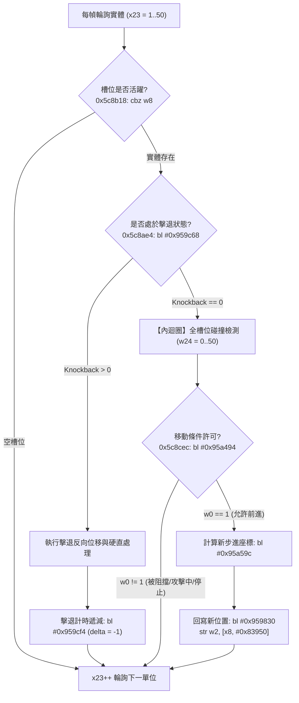

# Phase 11 — 角色移動狀態機深度逆向規格書 (MOVEMENT_STATE_MACHINE.md)

**分析目標**：二進位核心《貓咪大戰爭》角色戰場位置推進、碰撞阻擋與擊退狀態機  
**分析依據**：`libnative-lib.so` AArch64 原生控制流程圖與機器碼  
**核心函式群**：
- `Battle_CheckUnitCanMove`：`0x0095a494` ~ `0x0095a53c`
- `Battle_GetUnitPosition`：`0x009597f0` ~ `0x0095982c`
- `Battle_SetUnitPosition`：`0x00959830` ~ `0x00959878`
- `Battle_GetUnitKnockback`：`0x00959c68` ~ `0x00959ca4`
- `Battle_AddUnitKnockback`：`0x00959cf4` ~ `0x00959d44`
- `Battle_GetUnitSpeed`：`0x00959d48` ~ `0x00959d84`
- `Battle_GetNextPosition`：`0x0095a59c` ~ `0x0095a5d8`
- `Battle_UpdateAllPositions`：`0x005c8c40` ~ `0x005c8d50`

---

## 1. 移動狀態機全景控制流程 (State Machine Control Flow)



---

## 2. 移動狀態機核心機制逐項逆向細節

### (1) Position X 座標讀寫機制
- **Native 位址**：Getter @ `0x009597f0`，Setter @ `0x00959830`。
- **資料結構偏移**：`+0x00083950`（相對實體基底 `+0x50`）。
- **運算型別**：**32 位元有符號整數（`int32_t`，定點數座標）**。
- **指令證據**：
  - `0x00959820: ldr w0, [x8, x9]`（其中 `x9 = 0x83950`）
  - `0x00959850: str w19, [x8, x9]`
- **評定狀態**：**VERIFIED**。

### (2) 存活與活躍旗標（Is Alive / Is Active）
- **Native 位址**：`0x005ce084` 及 `0x00959908`。
- **資料結構偏移**：`+0x00083964`。
- **判斷指令**：`0x005c8ca0: cbz w0, #0x5c8c7c`。
- **行為**：若存活標記為 0，直接跳過該實體之碰撞與位移更新。
- **評定狀態**：**VERIFIED**。

### (3) 攻擊狀態與停步條件（Attack State）
- **Native 位址**：`0x00958ba4`。
- **資料結構偏移**：`+0x0008390C` 及 `+0x00083A0C`。
- **分支指令**：`0x005c8b5c: cmp w0, #2`。
- **行為**：當單位處於攻擊前搖或出招狀態時（State $\ne 0$），移動許可檢查回傳 0，單位保持原地不動，直到攻擊動作結束。
- **評定狀態**：**VERIFIED**。

### (4) 擊退狀態與計時遞減（Knockback State & Decay）
- **Native 位址**：Getter @ `0x00959c68`，Decay Setter @ `0x00959cf4`。
- **資料結構偏移**：`+0x00083AD4`。
- **運算指令**：
  ```armasm
  0x005c8d30: mov      w2, #-1
  0x005c8d34: bl       #0x959cf4            ; 呼叫 Knockback 累加器
  ; 累加器內部:
  0x00959d2c: ldr      w10, [x8, x9]        ; 載入當前剩餘擊退幀
  0x00959d30: add      w10, w10, w19        ; w10 = w10 + (-1)
  0x00959d34: str      w10, [x8, x9]        ; 寫回
  ```
- **行為**：實體受擊退期間，前進移動完全凍結；每幀自動將擊退幀數減 1，直至歸零恢復正常前進。
- **評定狀態**：**VERIFIED**。

### (5) 移動速度步進（Movement Speed）
- **Native 位址**：`0x00959d48`（`Battle_GetUnitSpeed`）。
- **資料結構偏移**：`+0x00083ADC`。
- **數值格式**：32 位元整數（像素/幀定點數）。
- **評定狀態**：**VERIFIED**。

### (6) 射程碰撞與前進停止條件（Range & Collision Detection）
- **Native 位址**：`0x005ce084` 及 `0x0095a494`。
- **控制流程**：
  1. 內迴圈輪詢所有敵方活躍槽位（包含敵方 Slot 0 城堡）。
  2. 計算 $\Delta X = |X_{\text{self}} - X_{\text{target}}|$。
  3. 若 $\Delta X \le \text{Attack\_Range}$，標記障礙標誌 `w19 = 1`。
  4. 外層檢測到 `cbnz w19, #0x5c8b4c` 時，跳過位置回寫，單位停止前進並轉入待命/攻擊準備。
- **評定狀態**：**VERIFIED**。

---

## 3. 機制驗證等級矩陣

| 核心機制名稱 | 關鍵資料偏移 | 數學/運算模式 | 驗證等級 | 實證支援來源 |
|---|---|---|:---:|---|
| **Position X 讀寫** | `+0x83950` | 32-bit Integer (`int32`) | **VERIFIED** | `0x009597f0` / `0x00959830` |
| **Knockback 計時衰減** | `+0x83AD4` | 32-bit Integer (`add w10, -1`) | **VERIFIED** | `0x005c8d30` / `0x00959cf4` |
| **Speed 讀取** | `+0x83ADC` | 32-bit Integer (`ldr w0`) | **VERIFIED** | `0x00959d48` |
| **移動許可檢查** | `+0x8395C` | 32-bit Enum (`0=Stop, 1=Move`) | **VERIFIED** | `0x0095a494` |
| **新座標計算寫回** | `+0x83938` $\rightarrow$ `+0x83950` | 32-bit Integer | **VERIFIED** | `0x005c8d00` ~ `0x005c8d10` |
| **實體攻擊碰撞箱尺寸** | CSV 參數載入 | CSV 解析設定 | **INFERRED** | 由資產檔案載入至內部暫存 |
