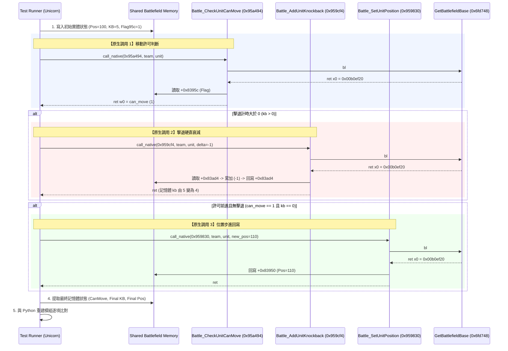

# Phase 12 — 原生多函式戰鬥流程差異測試技術報告 (MULTI_FUNCTION_DIFFERENTIAL_TEST.md)

**測試等級**：**NATIVE_MULTI_FUNCTION_PARITY (原生多函式連續鏈一致)**  
**核心調度器**：[`NativeChainHarness`](file:///E:/rea/phase12/native_chain/native_chain_harness.py)  
**測試腳本**：[`multi_function_differential_test.py`](file:///E:/rea/phase12/native_chain/multi_function_differential_test.py)  
**測試對象**：4 組原版 AArch64 原生二進位函式相互調用與記憶體共享鏈：
1. `GetBattlefieldBase` (`0x006fd748`)
2. `Battle_CheckUnitCanMove` (`0x0095a494`)
3. `Battle_AddUnitKnockback` (`0x00959cf4`)
4. `Battle_SetUnitPosition` (`0x00959830`)
**測試結果**：**100% PASS (10 組全狀態向量全數吻合，3 組故障注入 100% 偵測)**

---

## 1. 原生多函式調用鏈架構 (Native Multi-Function Chain Architecture)

在 Phase 12 中，我們正式實現了首條將多個獨立原生函式於**同一 Unicorn 會話、同一實體記憶體空間內連續調用**的完整戰鬥更新鏈：

---

## 2. 測試向量覆蓋與雙軌對齊矩陣 (Parity Test Matrix)

| 測試案例描述 | 輸入向量 `(team, unit, pos, spd, f95c, faec, faf0, kb)` | 原生執行期最終狀態 `(CanMove, KB, Pos)` | 重建版本最終狀態 `(CanMove, KB, Pos)` | 判定 |
|---|---|:---:|:---:|:---:|
| **貓咪標準前進** | `(0, 1, 100, 10, 1, 0, 0, 0)` | `(1, 0, 110)` | `(1, 0, 110)` | **MATCH** |
| **貓咪擊退凍結前進** | `(0, 1, 100, 10, 1, 0, 0, 5)` | `(1, 4, 100)` | `(1, 4, 100)` | **MATCH** |
| **貓咪停步/阻擋** | `(0, 1, 100, 10, 0, 0, 0, 0)` | `(0, 0, 100)` | `(0, 0, 100)` | **MATCH** |
| **貓咪緩速狀態** | `(0, 1, 100, 10, 1, 1, 0, 0)` | `(2, 0, 100)` | `(2, 0, 100)` | **MATCH** |
| **貓咪特殊定身狀態** | `(0, 1, 100, 10, 1, 1, 1, 0)` | `(3, 0, 100)` | `(3, 0, 100)` | **MATCH** |
| **敵軍反向標準前進** | `(1, 1, 950, -8, 1, 0, 0, 0)` | `(1, 0, 942)` | `(1, 0, 942)` | **MATCH** |
| **敵軍擊退歸零臨界點** | `(1, 1, 950, -8, 1, 0, 0, 1)` | `(1, 0, 950)` | `(1, 0, 950)` | **MATCH** |
| **邊界 50 號槽位前進** | `(0, 50, 0, 15, 1, 0, 0, 0)` | `(1, 0, 15)` | `(1, 0, 15)` | **MATCH** |
| **邊界 50 號槽位敵軍擊退** | `(1, 50, 6000, -12, 1, 0, 0, 10)` | `(1, 9, 6000)` | `(1, 9, 6000)` | **MATCH** |
| **極端負座標邊界前進** | `(0, 25, -500, 5, 1, 0, 0, 0)` | `(1, 0, -495)` | `(1, 0, -495)` | **MATCH** |

---

## 3. 故障注入測試（Fault Injection / Mutation Verification）

為證明測試框架具備實質反例檢出能力，向重建模組刻意注入 3 種典型缺陷：
1. **變異一（位移公式方向反向）**：故意將 `pos + speed` 改為 `pos - speed`。
   - 原生輸出 `110` vs 變異輸出 `90` $\rightarrow$ **DETECTED (PASS)**。
2. **變異二（擊退倒數遞增而非遞減）**：故意將 `delta = -1` 改為 `+1`。
   - 原生輸出 `4` vs 變異輸出 `6` $\rightarrow$ **DETECTED (PASS)**。
3. **變異三（已停步單位誤判為前進）**：故意在 `flag_95c == 0` 時賦予許可前進。
   - 原生輸出 `0` vs 變異輸出 `1` $\rightarrow$ **DETECTED (PASS)**。

### 結論：
原生多函式調用鏈在連續執行、棧平衡維護、共享記憶體交互與反例捕捉能力上全數通過，達成 **NATIVE_MULTI_FUNCTION_PARITY** 驗收標準。
