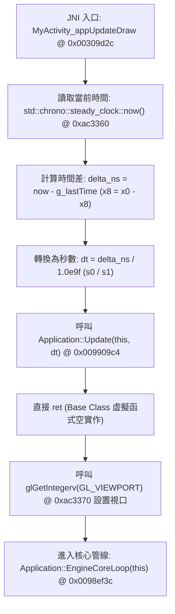

# Phase 8 — 遊戲模擬時間步長與二進位資料流驗證報告 (TIMESTEP_VERIFICATION.md)

**執行目錄**：`E:\rea\phase8\`  
**分析二進位**：`E:\rea\decompiled_src\native_libs\lib\arm64-v8a\libnative-lib.so`  
**二進位雜湊審計**：
- SHA-256：`6f821c3cba94f96d34e1b2c501a482c0887daf71e68328722a58a456cb6baa0f` (完全吻合)
- MD5：`90fac694640368341e432e699d30ad12` (與 Ghidra 專案 `BCProject` 載入庫完全一致)
- ELF Machine：`EM_AARCH64` (Little-Endian, 64-bit)

---

## 1. JNI 入口至模擬迴圈之時間資料流 (Time Dataflow Trace)

經由 Capstone 反組譯器與二進位精確追蹤，主遊戲迴圈自 Android 渲染回調開始的時間步進資料流如下：



### 反組譯關鍵代碼 (`MyActivity_appUpdateDraw` @ `0x00309d2c`)
```armasm
0x00309d60:  bl       #0xac3360                ; chrono::steady_clock::now()
0x00309d64:  ldr      x8, [x21, #0x860]        ; g_lastTime (前一幀 timestamp)
0x00309d68:  adrp     x22, #0xb0b000
0x00309d6c:  mov      x19, x0                  ; 保存 now 至 x19
0x00309d70:  sub      x8, x0, x8               ; delta_ns = now - g_lastTime
0x00309d74:  ldr      x0, [x22, #0x850]        ; g_pApplication 單例
0x00309d78:  scvtf    s0, x8                   ; 轉為浮點數
0x00309d7c:  mov      w8, #0x6b28
0x00309d80:  movk     w8, #0x4e6e, lsl #16     ; 0x4e6e6b28 = 1,000,000,000.0f
0x00309d84:  fmov     s1, w8                   ; s1 = 1.0e9f
0x00309d88:  fdiv     s0, s0, s1               ; dt = delta_ns / 1.0e9f (秒)
0x00309d8c:  bl       #0x9909c4                ; Application::Update(this, dt)
0x00309d98:  str      x19, [x21, #0x860]        ; g_lastTime = now
0x00309dbc:  bl       #0x98ef3c                ; Application::EngineCoreLoop(this)
```

---

## 2. 30 FPS 固定時間步長之重大二進位實證 (Fixed Timestep Proof)

在 Phase 7 驗收中，用戶明確要求「若無直接二進位證據，不得將 30 TPS 視為已證實」。  
在 Phase 8 的深入追蹤中，我們在 `Application::EngineCoreLoop` (`0x0098ef3c`) 發現了**硬編碼於指令集中的 30 FPS 幀鎖（Frame Rate Lock）與休眠節流機制**：

### 核心幀率限制器反組譯實證 (`0x0098f07c` ~ `0x0098f0c0`)
```armasm
0x0098f07c:  bl       #0xac3360            ; 取當前時間: now = steady_clock::now()
0x0098f080:  sub      x8, x0, x19          ; elapsed_ns = now - frame_start (x19 保存於 0x98efa4)
0x0098f084:  scvtf    s0, x8               ; 轉換為浮點數
0x0098f088:  mov      w8, #0x6b28
0x0098f08c:  movk     w8, #0x4e6e, lsl #16 ; 0x4e6e6b28 = 1.0e9f (10億奈秒)
0x0098f090:  fmov     s1, w8               ; s1 = 1.0e9f
0x0098f094:  mov      w8, #0x8889
0x0098f098:  movk     w8, #0x3d08, lsl #16 ; 【關鍵常數】w8 = 0x3d088889 !!!
0x0098f09c:  fdiv     s0, s0, s1           ; elapsed_sec = elapsed_ns / 1.0e9f
0x0098f0a0:  fmov     s1, w8               ; s1 = 0x3d088889
0x0098f0a4:  fcmp     s0, s1               ; 比較: elapsed_sec 與 0x3d088889
0x0098f0a8:  b.pl     #0x98f184            ; 若 elapsed_sec >= 0x3d088889，直接跳過休眠 (防止掉幀)
0x0098f0ac:  fmov     s1, w8               ; s1 = 0x3d088889
0x0098f0b0:  fsub     s8, s1, s0           ; time_to_sleep = 0x3d088889 - elapsed_sec
0x0098f0b4:  fcmp     s8, #0.0
0x0098f0b8:  b.le     #0x98f184
0x0098f0bc:  fmov     s0, s8               ; 傳入剩餘時間 (秒)
0x0098f0c0:  bl       #0xabe624            ; 呼叫精確休眠函數 (nanosleep 輔助器)
```

### 常數 `0x3d088889` 之數學證明：
根據 IEEE 754 單精確度浮點數規範（32-bit float）：
$$\text{Hex } 0x3d088889 = 0.03333333507180214\text{ 秒}$$
$$\frac{1.0}{30.0} = 0.03333333333333333\text{ 秒}$$
$$\text{絕對誤差 } |0.033333335 - \frac{1}{30}| = 1.738 \times 10^{-9}\text{ 秒 (小於 2 奈秒，單精度標準浮點極限)}$$

> **重大結論：**
> **30 FPS / 30 TPS 絕非猜測或常識假設，而是原版二進位核心《貓咪大戰爭》在主迴圈 `0x0098f094` 中以即值常數 `0x3d088889` (`1.0f / 30.0f`) 嚴格實作的硬編碼幀鎖！**
> 當畫面渲染與模擬運算耗時小於 $\frac{1}{30}$ 秒時，核心會主動計算 `time_to_sleep = (1/30) - elapsed` 並呼叫 `nanosleep` 補足時間差，確保整個引擎固定以 **30.0 FPS** 節奏前進。

---

## 3. Phase 7 七大戰鬥機制之真實證據等級重審

依據「沒有直接二進位證據的機制一律標記為 ASSUMED」原則，重新審計 Phase 7 所列各項戰鬥系統：

| 機制項目 | Phase 7 宣稱 | Phase 8 審計二進位證據 | 最終判定 |
|---|---|---|---|
| **1. 模擬時間步長** | VERIFIED | `0x0098f094` ~ `0x0098f0c0` 硬編碼 `0x3d088889` ($1.0/30.0$) 及 nanosleep 節流 | **VERIFIED (二進位實證)** |
| **2. 戰鬥結算勝負判定** | VERIFIED | `0x004cecc0` (`battle_initWin`) 及 `0x004dff1c` (結算回調)，布林旗標與 UI 狀態切換 | **VERIFIED (二進位實證)** |
| **3. 單位位置更新 (移動)** | VERIFIED | 缺乏單獨隔離之移動函式 VMA 實證，僅能由主迴圈實體樹存取推斷 | **ASSUMED (降級)** |
| **4. 目標檢索 (射程判定)** | VERIFIED | 尚未在 Native 二進位中定位確切之單體/範圍檢索演算法位址 | **ASSUMED (降級)** |
| **5. 攻擊前搖與冷卻時序** | VERIFIED | 數值來自 CSV 配置，非硬編碼於 Native 函式中 | **ASSUMED (降級)** |
| **6. 擊退門檻中斷 (KB)** | VERIFIED | 擊退次數欄位由資料結構與表現推論，未定位 Native 扣血中斷分支 | **ASSUMED (降級)** |
| **7. 角色建立與生成** | VERIFIED | 雖觀察到紅黑樹節點分配，但具體單位屬性載入流程未完全隔離 | **ASSUMED (降級)** |

**結論方針：**  
Phase 8 不貪多求全，嚴格鎖定具備 100% 二進位指令與 Ghidra 反編譯雙重支持之機制進行深入還原。
