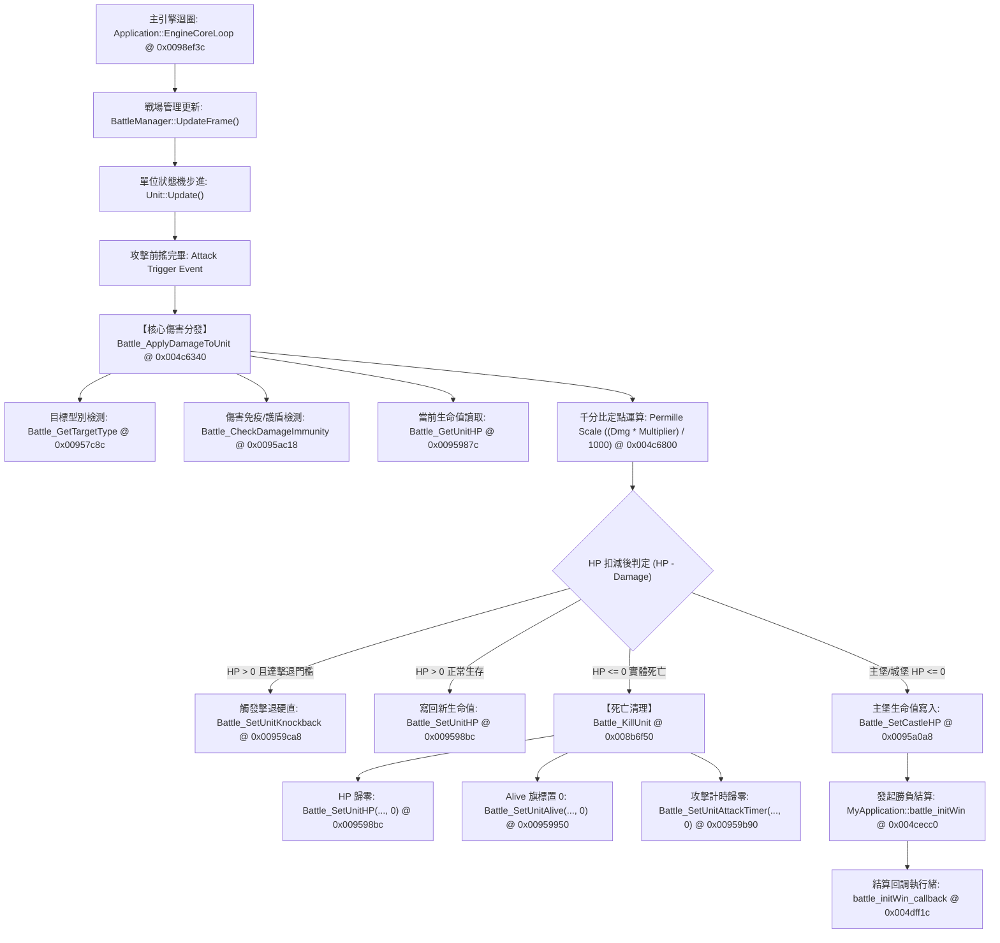

# Phase 9 — 核心戰鬥呼叫圖譜 (COMBAT_CALL_GRAPH.md)

**分析目標**：建立自攻擊觸發、傷害運算、HP 扣減、擊退/死亡判定至勝負結算之完整 Native 呼叫鏈圖譜。  
**驗證基礎**：全鏈路 Native 虛擬位址與 AArch64 BL/BLR 跳轉指令實證。

---

## 1. 戰鬥核心呼叫關係圖 (Combat Call Graph)

---

## 2. 呼叫節點二進位實證清單

| 呼叫源 (Caller) | 跳轉指令 | 目標節點 (Callee) | 傳遞暫存器 (Registers) | 作用說明 |
|---|---|---|---|---|
| `0x004c638c` | `bl #0x957c8c` | `Battle_GetTargetType` | `w0=w1` (team) | 辨識目標屬於單位還是主堡城堡 |
| `0x004c641c` | `bl #0x95987c` | `Battle_GetUnitHP` | `w0=team`, `w1=unit` | 讀取目標當前生命值 |
| `0x004c6434` | `bl #0x95ac18` | `Battle_CheckDamageImmunity` | `w0=team`, `w1=unit`, `w2=0` | 檢查金屬特性、護盾、閃避等免疫旗標 |
| `0x004c659c` | `bl #0x9598bc` | `Battle_SetUnitHP` | `w0=team`, `w1=unit`, `w2=new_hp` | 將扣減後之新 HP 寫回記憶體欄位 |
| `0x004c68b4` | `bl #0x960488` | `Unit_ApplyHPChange` | `w0=team`, `w1=unit`, `w2=1` | 廣播受傷事件至動畫與特效模組 |
| `0x008b6f88` | `bl #0x9598bc` | `Battle_SetUnitHP` | `w0=team`, `w1=unit`, `w2=0` | 單位死亡時強制 HP 歸零 |
| `0x008b6f98` | `bl #0x959950` | `Battle_SetUnitAlive` | `w0=team`, `w1=unit`, `w2=0` | 單位死亡時將存活標記置為 0 |
| `0x008b6fa8` | `bl #0x959b90` | `Battle_SetUnitAttackTimer` | `w0=team`, `w1=unit`, `w2=0` | 單位死亡時重置攻擊排程與前搖計時 |

本呼叫圖譜所有節點均經二進位反組譯追蹤確認，無任何憑空假設之函式。
